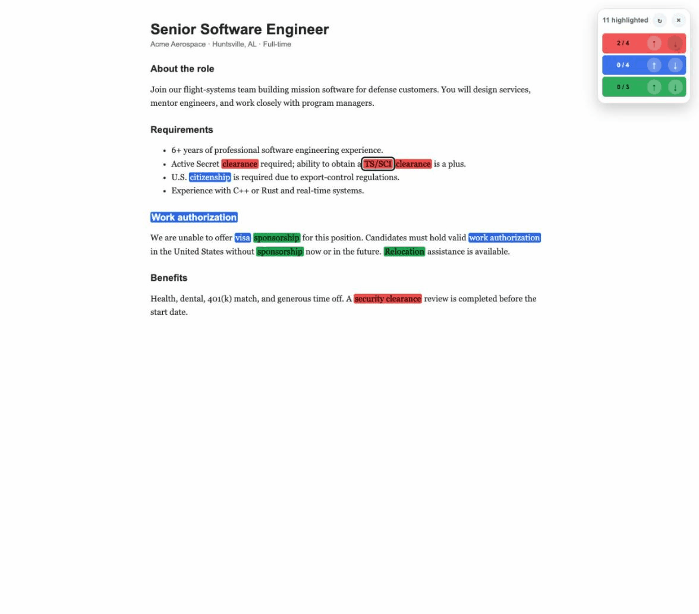
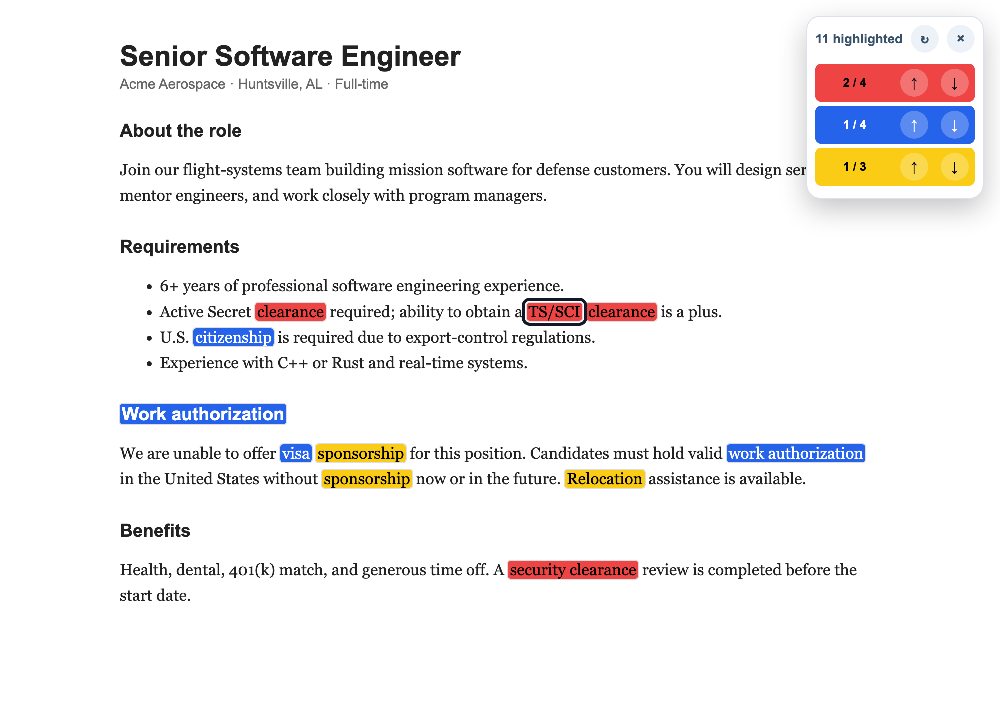
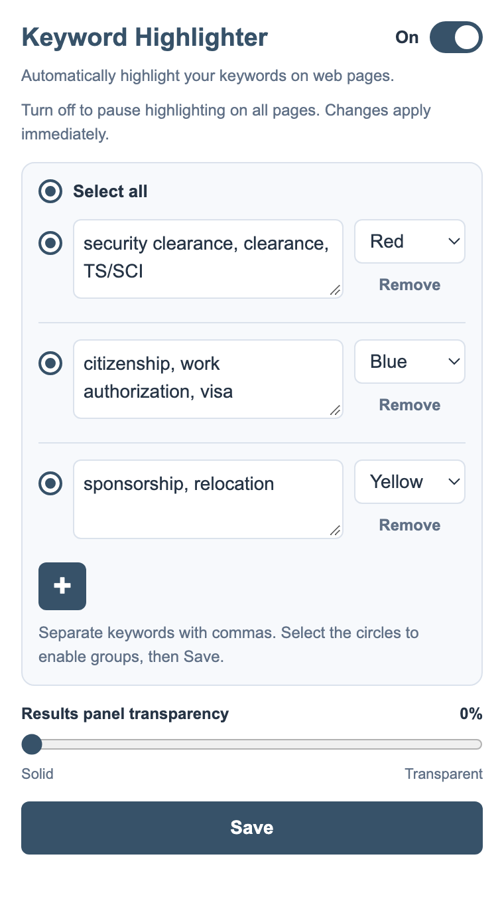

# Keyword Highlighter Chrome Extension

Chrome extension that automatically highlights keyword groups on web pages, with color-coded results and per-color match navigation.

## Features

- Configure words such as `clearance`, `citizenship`, and `sponsorship`.
- Automatically scans and highlights matching words when a page loads.
- Click the extension icon to open a settings popup with comma-separated keywords and highlight colors.
- Add keyword groups with the **+** button and choose red, blue, green, yellow, orange, purple, or pink for each group.
- Save to update highlights on open pages immediately.
- Adds a floating on-page results panel with previous/next match navigation.
- Shows a light floating panel with one fully colored table row per active color, displaying the match position/total and previous/next arrows. Each row navigates only its own color and remembers its position independently. Colors with no matches have disabled arrows. Use **×** to close the control while keeping page highlights visible. It reappears at the top-right corner on the next scan or page reload.
- Drag the floating panel anywhere; it moves freely up and down and snaps to the nearest left or right screen margin.

## Demo

## Screenshots

Highlighted keywords on a sample job posting, with the floating results panel (one row per color, with its own match counter and prev/next arrows):

The settings popup, with keyword groups, colors, the On/Off switch, and panel transparency:

## Load in Chrome

1. Open `chrome://extensions`.
2. Turn on **Developer mode**.
3. Click **Load unpacked**.
4. Select this project folder.

## Set Words

Click the extension icon, enter comma-separated words or phrases, choose a highlight color, and click **Save**. The same settings are also available by right-clicking the icon and choosing **Options**. Line-separated keywords are supported too. Clearing all keywords and saving removes the highlights.

Use the **On/Off** switch beside **Keyword Highlighter** to activate or deactivate highlighting across all pages immediately, without clicking **Save**. Turning it off removes existing highlights and the floating results panel. Your keyword groups, colors, and transparency settings are preserved. Turning it back on scans open pages again. The switch defaults to on and remembers your choice across browser restarts.

Click **+** to add another keyword group with its own color, or **Remove** to delete a group. Existing keywords and color are preserved as the first group. When a keyword appears in multiple groups, the first group's color wins. Longer phrases take precedence over shorter matches at the same position.

Use the circular toggle on the left to enable or disable each group independently, then click **Save**. Disabled groups keep their keywords and colors but are excluded from highlighting. Existing groups start enabled.

Use **Select all** above the groups to enable or disable every group, then click **Save**. A dash indicates that only some groups are enabled.

Use the **Results panel transparency** slider in the settings popup and click **Save** to fade the entire floating panel, including its background, color rows, counts, and controls, from solid (0%) to invisible (100%). At 100%, the panel does not intercept clicks or keyboard focus. Page highlights keep their original colors. This preference is saved and updates open pages without rescanning.

## Use

Open or reload a web page, and the configured words will be highlighted automatically. Click **↻** next to **×** in the floating panel to scan the current page again without reloading it.

After updating the extension, click its reload button in `chrome://extensions`, then reload any already-open pages. To highlight local files, enable **Allow access to file URLs** in the extension's details.

## Matching Rules and Limitations

- Matching is case-insensitive and whole-word, so `clear` does not match `clearance`.
- Text inside `<code>`, `<pre>`, inputs, textareas, selects, and iframes is not highlighted.
- Pages are scanned once when they finish loading. Pages that render content later (single-page apps and many job sites) may need **↻** in the floating panel to pick up new text.
- Phrases are matched within a single text node, so a phrase split across tags (for example `security <b>clearance</b>`) is not matched.
- Clicking the panel body, or pressing Enter or Space while it is focused, scans again. In the settings popup, Cmd/Ctrl+Enter saves.
- Settings are stored in `chrome.storage.sync`, so they follow your Chrome profile across devices. The only permission requested is `storage`.
- The extension runs on `http://`, `https://`, and `file://` pages.

## License

Released under the [MIT License](LICENSE).
